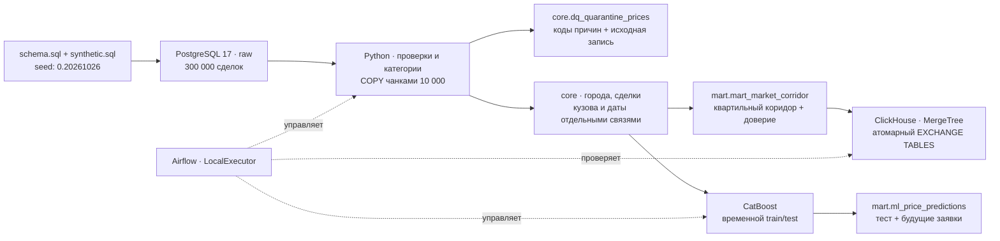

# Smart Logistics: хранилище и прогнозирование тарифов

Воспроизводимое решение тестового задания Middle Data Engineer: PostgreSQL 17, Python ETL, SQL-витрина рыночного коридора, CatBoost, Apache Airflow и реплика витрины в ClickHouse. Исходное задание сохранено в [docs/original-assignment.md](docs/original-assignment.md), приложения — в [docs/attachments](docs/attachments).

## Запуск

Требования: Docker Desktop с Linux containers / WSL2, Docker Compose v2, доступ к Docker Hub и PyPI. Рекомендуется выделить Docker 8 ГБ RAM и 4 CPU; свободные порты — 55432 и 8080. Локальный Python не нужен.

Из корня репозитория:

```bash
docker compose up
```

Если установлен старый alias, эквивалентная команда — `docker-compose up`. Обязателен Compose с поддержкой `service_healthy` и `service_completed_successfully`; устаревший Compose v1 не поддерживается. `.env` не требуется. Для изменения локальных настроек можно скопировать `.env.example` в `.env`.

Compose автоматически подхватывает `docker-compose.override.yml`: Airflow является оркестратором по умолчанию. PostgreSQL проходит healthcheck, автоматически создаётся metadata DB Airflow, выполняются миграции и создаётся демонстрационный пользователь. Неразрешённых DAG нет: `smart_logistics` сразу включён, `@daily`, `catchup=False`, один активный запуск. Первый актуальный интервал запускается самим scheduler. Перезапуск контейнеров в тот же день не создаёт дополнительные конфликтующие DAG Run. Повторная ежедневная обработка не пересоздаёт источник и не переобучает неизменившуюся модель.

Первая сборка загружает образы и зависимости. После неё генерация и обработка 300 000 сделок занимает несколько минут. В Airflow UI [localhost:8080](http://localhost:8080), пользователь `admin`, демонстрационный пароль `local_demo_only`. Логи задач доступны в UI; успешный конец — задача `verification`, все задачи зелёные, сообщение `PIPELINE_SUCCESS`. Ошибки завершают задачу с ошибкой и включают retries; они не превращаются в успешный exit code.

```bash
docker compose ps -a
docker compose logs airflow-init airflow-scheduler
```

Демонстрационные пароли предназначены для локального стенда. Внешний доступ PostgreSQL и Airflow ограничен loopback. ClickHouse доступен только внутри Docker-сети. Для общего стенда измените пароли и signing key; для `POSTGRES_PASSWORD` в URL Airflow используйте URL-safe значение.

## Архитектура



Последовательность DAG: `source_init → etl → dwh_marts → ml_training → batch_scoring → clickhouse_sync → verification`. Бизнес-логика находится в `etl/` и `ml/`; DAG содержит зависимости и параметры. LocalExecutor не требует Redis и отдельных worker-контейнеров. У задач 2 повтора, таймаут 40 минут; между задачами нет фиксированных ожиданий готовности сервисов.

Все стадии используют общий PostgreSQL advisory lock. Изменения Core, карантина, связей и витрины публикуются транзакционно; читатель видит прежнюю или новую версию. После backfill витрина пересчитывается целиком, включая все месяцы долгосрочных заявок. Для 300 тысяч строк полный пересчёт проще и надёжнее сложной инвалидации месячных агрегатов. Увеличение объёма потребует инкрементального пересчёта затронутых месяцев.

## Raw → Core → Mart

* `raw`: неизменённые `schema.sql` и `synthetic.sql`, 300 000 сделок. Генерация выполняется `psql -X --single-transaction -v ON_ERROR_STOP=1`. Маркер `raw.bootstrap` записывается в той же транзакции: повторный запуск безопасен, частично созданный источник не считается готовым.
* `core.cities`: одна строка на `gc_id`, минимальный `cities.id`; регион извлечён после первой запятой, неизвестный регион обозначен явно.
* `core.prices`: одна очищенная сделка на исходный `id`, цена RUB без НДС, происхождение курса, сохранённый исходный `outlier_mark`.
* `core.price_body_groups`: уникальная пара `price_id × body_group`. `std_id` нормализует дочерние кузова; одинаковая группа не размножается. Если связи нет, используется `prices.body_type`, затем `Не указан`; остальные коды — `Прочие`.
* `core.price_months`: развертка `price_dates`. Долгосрочная сделка может войти в несколько месяцев. Внутри одной группы и календарного месяца она учитывается один раз.
* `mart`: отдельные физические таблицы коридора, прогнозов и метаданных модели. Первичные/уникальные ключи защищают зерно; индексы покрывают даты обработки и маршрутные запросы.

Общее число членств в рыночных ячейках не равно числу сделок: одна сделка может относиться к нескольким различным кузовам и месяцам. Суммировать `trips_count` между такими группами как уникальное число перевозок нельзя.

## ETL и Data Quality

Проверяются конечные положительные цены и расстояния, неотрицательные вес и объём, наличие обоих городов. Для RUB дополнительно отклоняется `price <= 1000`; валютная цена ниже 1000 сама по себе допустима. Совпадающие города не отклоняются. Все причины сохраняются массивом в `core.dq_quarantine_prices`; запись может иметь несколько причин. Статистика чтения, принятия и карантина выводится в структурированные логи.

USD/EUR конвертируются только по точному соответствию `currency_code × nearest_rate_date`. Дубликаты курса детерминированно разрешаются минимальным `exchange_rates.id`. RUB имеет курс 1 без требования даты. Отсутствующий валютный курс означает карантин; подстановок по `loading_date` и произвольных курсов нет. `nearest_rate_date` уже рассчитана источником относительно `created_at`; ETL не заменяет её другим поиском даты.

Пропущенная весовая категория заполняется по весу после округления до 0,1 т (decimal HALF_UP): `G20T ≥30`, `FTL [10;30)`, `10T [5;10)`, `5T [2,5;5)`, `L5T [0,5;2,5)`, иначе `OTH`. Объёмная: `FTL`, когда `0 < V <= 120`, иначе `OTH`. Непустые исходные категории сохраняются.

Флаг выброса сохраняется без пересчёта; `true` исключает сделку из исторического рынка и train/test, но не является признаком модели. **Ограничение источника:** свежие сделки 26 октября 2026 года могут ещё не иметь корректной ночной разметки аномалий. Значение `false` не гарантирует отсутствие выброса. Дополнительная очистка по цене не выполняется; метрики отражают это ограничение.

## Рыночная витрина

Зерно: `month × loading_city_gcid × unloading_city_gcid × body_group × weight_category`. Объёмная категория не включена в зерно. Месяц берётся из `price_dates.price_date`; даты после фиксированного `as_of = 2026-10-26` исключаются **до** сведения к месяцу. Используются факты типов `1,2,3,4,5,9`, простые маршруты, валидные RUB-цены и исходный `outlier_mark=false`.

`p25_trip / median_trip / p75_trip / avg_trip` рассчитываются по `price_rub`; `p25_km / median_km / p75_km` — по `price_rub/distance`. `trips_count` считает уникальные сделки в ячейке; `carriers_count` — организации только для типов `3,9`; `cv_rate` — выборочное стандартное отклонение / среднее, NULL для одиночной строки.

MoM и YoY используют JOIN по точному предыдущему календарному месяцу и тому же месяцу прошлого года. Если сравнения нет, результат NULL. Свежесть определена как возраст даты, представляющей месяц (`as_of - month`, где `month` — первое число); в данном снимке `HIGH` возможен для октября при ≥30 сделках и ≥5 перевозчиках. `MEDIUM` — ≥10 сделок, иначе `LOW_DATA`.

Запросы для проверки всех показателей, валют, карантина, прогнозов и SQL smoke-проверки находятся в [sql/checks.sql](sql/checks.sql). Пример выполнения:

```bash
docker compose cp sql/checks.sql postgres:/tmp/checks.sql
docker compose exec -T postgres psql -U logistics -d logistics -v ON_ERROR_STOP=1 -f /tmp/checks.sql
```

## ML: признаки, валидация и скоринг

CatBoostRegressor: 550 деревьев, depth=7, learning_rate=0,06, RMSE, CPU, 2 потока, seed=20261026. Явный allowlist признаков находится в [ml/features.py](ml/features.py): отдельные города и регионы отправления/назначения, координаты, расстояние, вес, объём, группы кузова, весовая и объёмная категории, год, месяц, день недели/года и sin/cos для циклических компонент. На сделку приходится одна строка: набор групп кузова отсортирован и соединён в категорию.

В признаки не попадают цена, удельные цены, НДС, прибыль, `price_group_id`, `price_group_stats` или `outlier_mark`. Исторические финансовые агрегаты не используются. CatBoost обучает обработку категорий только на train; статистических импутеров и подгонки трансформеров на test нет. Данные сортируются по дате и id, `has_time=True`. Test не используется как `eval_set`, для early stopping или выбора параметров.

Train строго `[2026-07-26, 2026-10-05)`, test — `[2026-10-05, 2026-10-26]`. Только исторические валидные фактические простые перевозки без исходного флага выброса. Граница 5 октября входит исключительно в test. Системная дата не меняет окна.

Будущие строки — все прошедшие DQ заявки с `loading_date > 2026-10-26`, включая торги и сложные маршруты: для них доступен прогноз, но сложные маршруты находятся вне обучающего домена. `actual_price_rub`, `abs_error_rub`, `ape_pct` у будущих заявок всегда NULL, что дополнительно закреплено CHECK-ограничением PostgreSQL. Прогноз для сложного будущего маршрута следует трактовать с осторожностью. Невалидные исходные заявки остаются в карантине и не скорятся.

Модель сохраняется в Docker volume `artifacts`, её имя определяется хешем обучающих признаков, таргета и параметров. Повторный запуск с тем же train загружает модель из кэша. Прогнозы атомарно заменяются, `price_id` уникален. `scored_at` отражает время последнего скоринга, остальные значения воспроизводимы. Метрики сохраняются в `mart.ml_runs` и `artifacts/model.json`.

Фактически измеренные значения и подтверждение финальной проверки — в [docs/validation.md](docs/validation.md); машинный отчёт модели — [docs/model-metrics.json](docs/model-metrics.json). Референсные значения из приложения задания не используются как результаты решения.

| Метрика на 12 808 тестовых сделках | Полученное значение |
|---|---:|
| R² | 0,919444 |
| MAPE | 15,7969% |
| RMSE | 54 297,15 ₽ |
| MAE | 28 352,59 ₽ |

В train — 24 226 сделок. Сохранено 18 806 прогнозов, в том числе 5 998 будущих заявок. Модель намеренно не подгоняется к ориентиру R&D; остаточный шум, неоднородные роли фактов и неполная разметка аномалий остаются в оценке.

## Backfill и повторные запуски

В UI Airflow: `smart_logistics → Trigger DAG w/ config`, например:

```json
{"start_date":"2026-09-01","end_date":"2026-09-30"}
```

Обе границы включительны, фильтрация по исходной `loading_date`. Core вне окна сохраняется, а витрины и скоринг пересчитываются целиком, чтобы обновить все зависимые месяцы. Обучение использует неизменные заданием окна; при неизменном train новая модель не обучается.

После завершения активного DAG можно запустить те же модули через CLI:

```bash
docker compose run --rm pipeline etl --start-date 2026-09-01 --end-date 2026-09-30
docker compose run --rm pipeline dwh_marts
docker compose run --rm pipeline ml_training
docker compose run --rm pipeline batch_scoring
docker compose run --rm pipeline clickhouse_sync
docker compose run --rm pipeline test
```

Не запускайте ручную цепочку одновременно с автоматическим DAG: отдельные операции сериализуются lock, но последовательности разных запусков могут чередоваться. Airflow штатно сериализует целые DAG Run через `max_active_runs=1`.

Для работы обязательного PostgreSQL-контура без бонусов:

```bash
docker compose -f docker-compose.yml up -d postgres
docker compose -f docker-compose.yml run --rm --no-deps -e CLICKHOUSE_URL= pipeline run
```

ClickHouse не участвует в расчётах PostgreSQL: его отказ не меняет данные Core/Mart. В полном DAG отказ синхронизации отмечает запуск как неуспешный и требует повтора.

## Бонусы и проверки

Airflow выполняет настоящую последовательность ETL/ML. ClickHouse содержит копию всей рыночной витрины на `MergeTree`. Загрузка идёт во staging, затем `EXCHANGE TABLES` атомарно публикует новую версию в Atomic database. Ошибка при загрузке сохраняет прежнюю рабочую таблицу. Автотест сравнивает **каждую строку и каждый показатель** PostgreSQL и ClickHouse с допуском для float и проверяет повторную синхронизацию.

`verification` запускает pytest: границы DQ, точный курс, минимальный id города, уникальность связей/зерна, независимый пересчёт квартилей через NumPy, MoM/YoY, реальный пересчёт ML-метрик, будущие NULL, полное повторное выполнение, частичный backfill и тестовые краевые записи с исправлением валидной сделки на невалидную. Последний тест очищает свои записи в `finally`. Проверяется хеш содержимого таблиц; timestamp скоринга исключён как технический атрибут. JUnit-отчёт сохраняется в volume artifacts.

Superset и его дашборд **не реализованы**. Оригинальный HTML — только входной продуктовый прототип, он не подключён к БД и не выдаётся за готовый BI. Дальнейшее улучшение: версионируемый Superset import, read-only BI роль, мониторинг drift, контроль зрелости ночных меток и инкрементальные месячные расчёты.

## Очистка и публикация

После изучения результатов можно остановить и удалить только ресурсы стенда:

```bash
docker compose --profile manual down --volumes --remove-orphans
docker image rm smart-logistics-de-test-pipeline:local smart-logistics-de-test-airflow:local
```

Перед удалением образов убедитесь, что их не используют другие контейнеры. Исходные образы PostgreSQL, Python, ClickHouse и Airflow являются общими и не удаляются. Глобальные prune не нужны. Результаты выполненной проверки в `docs/` остаются; наборы данных и `.cbm` воспроизводятся автоматически и в Git не включаются.

Папка готовится как отдельный Git-репозиторий. Для публикации создайте пустой репозиторий GitHub, проверьте содержимое, сделайте commit и добавьте remote. Автоматической публикации нет. На другой машине достаточно клонировать **всю** папку, включая оба Compose-файла, и выполнить `docker compose up`.
